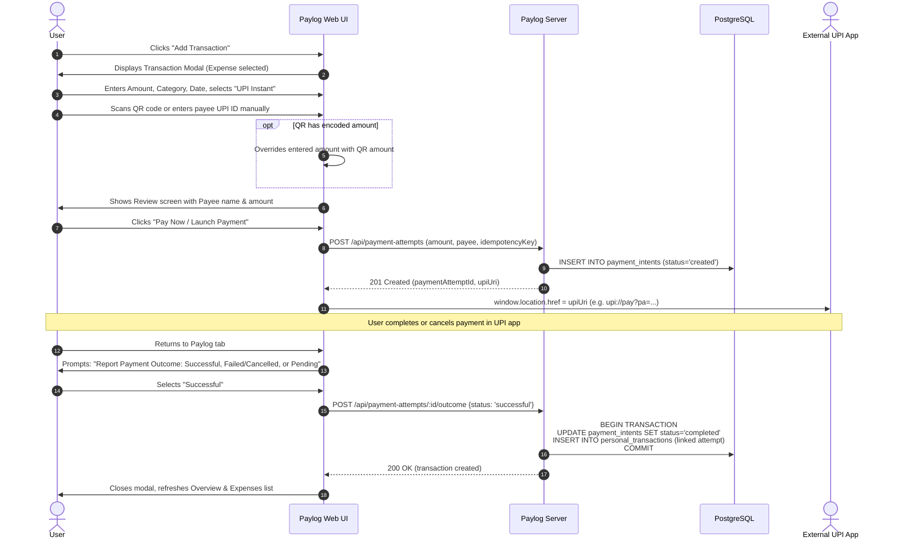

# Paylog — Users, Permissions & User Journeys

**Document:** 02-users-and-journeys.md  
**Author:** Paylog Engineering Team  
**Date:** October 2026  
**Status:** Approved Specification  

---

## 1. User Types & Roles

| User Type | Identification | System Capabilities & Permissions |
| :--- | :--- | :--- |
| **Individual User** | Authenticated via Server Session (Email/Password or Google OAuth) | - Full read/write access to own profile, budget, categories, personal transactions, payment attempts, and reports.<br>- Strictly restricted from viewing or modifying other users' data. |
| **Group Organizer** | Registered Paylog User who created the group | - Can edit group metadata, add/remove members, record shared expenses, and record settlements.<br>- Retains administrative privileges within the group. |
| **Group Member** | Registered Paylog User accepted into the group | - Can view group details, group expenses, member shares, net balances, and record group expenses/settlements.<br>- Cannot modify group settings or delete members. |
| **Registered Friend** | Connected Paylog user via accepted friendship | - Can be added to groups via 1-click friend picker.<br>- Can participate in 1-on-1 shared expenses and settlements. |
| **Manual / Offline Participant** | Name-based participant record within a group (optional email/UPI ID) | - Cannot log into Paylog or access API endpoints.<br>- Stored as participant metadata to calculate group shares and debt balances.<br>- Having an email or UPI ID does NOT grant account access. |
| **Demo User** | Ephemeral, isolated fictional account session | - Operates on pre-populated fictional financial data.<br>- Completely isolated from real production records; cannot mutate or query real accounts. |

---

## 2. Authentication & Session Security Model

1. **Authentication Providers:**
   - **Email & Password:** Password hashed with `bcryptjs` (cost factor 10+), validated via secure credential check.
   - **Google OAuth (Ready):** OAuth callback verifies Google tokens, links or creates the user record, and establishes a session.
2. **Session Architecture:**
   - **PostgreSQL-Backed Session Store:** Uses `connect-pg-simple` with `session` table in PostgreSQL. No in-memory session leaks.
   - **Cookie Configuration:**
     - `name`: `paylog.sid`
     - `httpOnly`: `true` (prevents XSS extraction)
     - `secure`: `true` in production (HTTPS only)
     - `sameSite`: `'lax'` (or `'none'` with `secure: true` if cross-origin required)
     - `maxAge`: 7 days rolling expiration
3. **Session Termination (Logout):**
   - Server-side session record deleted from PostgreSQL on `POST /api/auth/logout`.
   - Browser cookie cleared immediately.
4. **Authorization Rule:**
   - The browser-supplied `userId` is **never trusted**.
   - `req.session.userId` derived strictly from the decrypted, server-validated session cookie dictates user identity for all queries.

---

## 3. Core User Journeys

### Journey 1: Personal Expense with UPI Instant Workflow


### Journey 2: UPI Fallback / Manual Fallback
1. User attempts QR scan or UPI app launch.
2. If camera is denied or UPI app fails to open, UI displays **"UPI Not Working? Pay Manually"**.
3. The transaction form draft is preserved without re-typing.
4. User completes payment externally or pays via cash/card, marks payment method as `UPI Instant` (path: `manual`).
5. Transaction is saved directly as a completed personal expense without launching a deep link.

### Journey 3: Pending Payments Management
1. User initiates UPI payment but returns without immediate confirmation, choosing "Pending" (or browser closes before reporting).
2. The Dashboard displays a **Pending Payments** shortcut badge (e.g. "2 Pending Payments").
3. User clicks the shortcut to open the Pending Payments view.
4. Each attempt displays amount, payee UPI ID/name, timestamp, and two instant actions: **Mark Successful** and **Mark Failed/Cancelled**.
5. Clicking an action sends an idempotent outcome request to the server, creating the single ledger entry on success and updating the dashboard immediately without extra confirmation popups.

### Journey 4: Retry Failed Payment Attempt
1. A payment attempt is recorded as failed or cancelled.
2. User selects **Retry Payment** from the attempt view.
3. Paylog reloads the original transaction details (amount, category, description) while allowing payee modification or a new QR scan.
4. Server creates a new linked `payment_intent` with `previous_attempt_id` referencing the failed attempt.
5. Historical failed attempt remains intact for audit integrity; only the new attempt can yield a completed expense.

### Journey 5: Cash & Other Personal Transactions
1. User opens **Add Transaction**.
2. Selects type: **Expense** or **Income**.
3. Selects payment method: **Cash** or **Other**.
4. Clicks **Save Transaction**.
5. Server validates input and persists to `personal_transactions`. No external intents are launched.

### Journey 6: Group Creation with Friends & Manual Members
1. User navigates to **Groups** and clicks **+ Create New Group**.
2. Enters group name (e.g., "Goa Trip 2026"), group type ("Trip"), and optional description.
3. In the **Members** section:
   - Creator is automatically added once ("You").
   - User clicks **Add Friend** to select an accepted Paylog friend from a dropdown.
   - User clicks **Add Manual Member** to type a display name (e.g., "Karan") with optional UPI ID/email.
4. User clicks **Create Group**.
5. Server persists the group and member associations atomically in PostgreSQL.

### Journey 7: Group Expense Equal Split & Remainder Distribution
1. Inside a group, user clicks **Add Group Expense**.
2. Enters Amount (e.g., ₹1000.00), Description ("Dinner"), Date, Payer ("Abhishek"), and Participants ("Abhishek", "Rohit", "Priya").
3. Server executes deterministic equal split:
   - Total paise: 100,000 paise.
   - 3 participants: 100,000 / 3 = 33,333 paise per person, remainder = 1 paisa.
   - Payer or first participant gets remainder: Abhishek = 33,334 paise, Rohit = 33,333 paise, Priya = 33,333 paise.
   - Sum of shares = 100,000 paise exactly.
4. Persisted in `shared_expenses` and `shared_expense_allocations` inside a PostgreSQL transaction.
5. Group view updates to show updated member balances and viewer-centric perspective ("You are owed ₹666.66").

### Journey 8: Debt Simplification & Settle Up
1. Members accumulate bilateral debts across multiple expenses.
2. Paylog computes net balances for each member and runs graph debt simplification to minimize total transfers.
3. User clicks **Settle Up**, chooses payer and recipient, amount, and payment method.
4. Recorded settlement creates an immutable entry in `settlements`, updating net balances atomically.

### Journey 9: Group Summary Sharing
1. User clicks **Share Summary / Copy Summary** on the group detail page.
2. System formats a human-readable text block:
   ```text
   Goa Trip 2026 — Shared Expense Summary
   Total shared expenses: ₹12,500.00
   Members: Abhishek, Rohit, Priya, Karan
   Balances:
   - Rohit owes Abhishek ₹2,500.00
   - Karan owes Abhishek ₹1,250.00
   (Generated via Paylog. Please verify with group organizer.)
   ```
3. Copies to clipboard or opens native mobile share sheet. Does not claim external message delivery.

### Journey 10: Reports & Safe CSV Export
1. User navigates to **Reports**.
2. Selects month/year filter.
3. Server aggregates completed income, completed expenses, net cash flow, and category breakdown.
4. If monthly budget is configured, shows budget gauge and remaining budget (or overspending state).
5. User clicks **Export CSV**.
6. Server streams sanitized CSV with formula-injection escaping (`'`, `"` wrapping) containing only the authenticated user's records.
