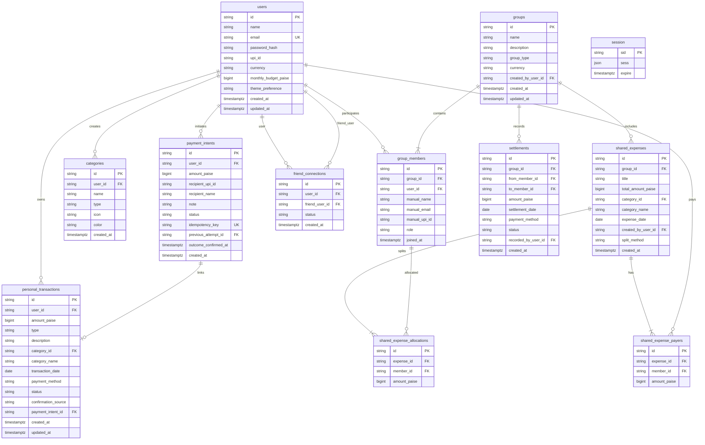

# Paylog — Data Model & Database Architecture

**Document:** 04-data-model.md  
**Author:** Paylog Engineering Team  
**Date:** October 2026  
**Status:** Approved Specification  

---

## 1. Principles & Money Handling

1. **Integer Paise Representation:**
   All monetary amounts in the database are stored as `BIGINT` representing integer Paise (1 INR = 100 Paise).
   - Example: ₹1,250.50 is stored as `125050`.
   - Prevents IEEE 754 floating-point inaccuracies during summation, splitting, and settlement.
2. **Deterministic Remainder Allocation:**
   When dividing $A$ paise among $N$ participants:
   $$\text{base} = \lfloor A / N \rfloor, \quad \text{remainder} = A \pmod N$$
   The first $\text{remainder}$ participants receive $\text{base} + 1$ paise, and the remaining receive $\text{base}$ paise.
   $$\sum_{i=1}^{N} \text{share}_i = A \quad (\text{exact})$$
3. **Auditing & Timestamps:**
   Every table maintains `created_at TIMESTAMPTZ NOT NULL DEFAULT CURRENT_TIMESTAMP`. Entities subject to modification maintain `updated_at`.
   `transaction_date` (the user-editable accounting date) is stored separately from `created_at` (the immutable server timestamp).

---

## 2. Entity-Relationship Diagram



---

## 3. Detailed Entity Schemas

### 3.1 `users` Table
```sql
CREATE TABLE IF NOT EXISTS users (
    id VARCHAR(64) PRIMARY KEY,
    name VARCHAR(120) NOT NULL,
    email VARCHAR(255) NOT NULL UNIQUE,
    password_hash VARCHAR(255),
    upi_id VARCHAR(100),
    currency VARCHAR(10) NOT NULL DEFAULT 'INR',
    monthly_budget_paise BIGINT CHECK (monthly_budget_paise IS NULL OR monthly_budget_paise >= 0),
    theme_preference VARCHAR(20) NOT NULL DEFAULT 'light' CHECK (theme_preference IN ('light', 'dark')),
    is_demo BOOLEAN NOT NULL DEFAULT FALSE,
    created_at TIMESTAMPTZ NOT NULL DEFAULT CURRENT_TIMESTAMP,
    updated_at TIMESTAMPTZ NOT NULL DEFAULT CURRENT_TIMESTAMP
);
CREATE INDEX IF NOT EXISTS idx_users_email ON users(email);
```

### 3.2 `session` Table (Express Session Store)
```sql
CREATE TABLE IF NOT EXISTS "session" (
    "sid" VARCHAR NOT NULL COLLATE "default",
    "sess" JSON NOT NULL,
    "expire" TIMESTAMPTZ NOT NULL,
    CONSTRAINT "session_pkey" PRIMARY KEY ("sid")
);
CREATE INDEX IF NOT EXISTS "IDX_session_expire" ON "session" ("expire");
```

### 3.3 `categories` Table
```sql
CREATE TABLE IF NOT EXISTS categories (
    id VARCHAR(64) PRIMARY KEY,
    user_id VARCHAR(64) REFERENCES users(id) ON DELETE CASCADE, -- NULL for system defaults
    name VARCHAR(100) NOT NULL,
    type VARCHAR(20) NOT NULL DEFAULT 'expense' CHECK (type IN ('expense', 'income')),
    icon VARCHAR(64) NOT NULL DEFAULT 'Tag',
    color VARCHAR(30) NOT NULL DEFAULT '#1E40AF',
    created_at TIMESTAMPTZ NOT NULL DEFAULT CURRENT_TIMESTAMP
);
CREATE INDEX IF NOT EXISTS idx_categories_user ON categories(user_id, type);
```

### 3.4 `personal_transactions` Table
```sql
CREATE TABLE IF NOT EXISTS personal_transactions (
    id VARCHAR(64) PRIMARY KEY,
    user_id VARCHAR(64) NOT NULL REFERENCES users(id) ON DELETE CASCADE,
    amount_paise BIGINT NOT NULL CHECK (amount_paise > 0 AND amount_paise <= 1000000000), -- max ₹10,000,000
    type VARCHAR(20) NOT NULL CHECK (type IN ('expense', 'income')),
    description VARCHAR(255) NOT NULL,
    category_id VARCHAR(64) REFERENCES categories(id) ON DELETE SET NULL,
    category_name VARCHAR(100) NOT NULL,
    transaction_date DATE NOT NULL,
    payment_method VARCHAR(40) NOT NULL CHECK (payment_method IN ('upi_instant', 'cash', 'other')),
    recipient_or_merchant VARCHAR(120),
    notes TEXT,
    status VARCHAR(30) NOT NULL DEFAULT 'completed' CHECK (status IN ('completed', 'pending', 'failed', 'cancelled')),
    confirmation_source VARCHAR(40) NOT NULL DEFAULT 'manual' CHECK (confirmation_source IN ('manual', 'upi_intent', 'already_paid')),
    payment_intent_id VARCHAR(64) UNIQUE,
    created_at TIMESTAMPTZ NOT NULL DEFAULT CURRENT_TIMESTAMP,
    updated_at TIMESTAMPTZ NOT NULL DEFAULT CURRENT_TIMESTAMP
);
CREATE INDEX IF NOT EXISTS idx_trans_user_date ON personal_transactions(user_id, transaction_date DESC);
CREATE INDEX IF NOT EXISTS idx_trans_status ON personal_transactions(status);
```

### 3.5 `payment_intents` Table
```sql
CREATE TABLE IF NOT EXISTS payment_intents (
    id VARCHAR(64) PRIMARY KEY,
    user_id VARCHAR(64) NOT NULL REFERENCES users(id) ON DELETE CASCADE,
    amount_paise BIGINT NOT NULL CHECK (amount_paise > 0 AND amount_paise <= 1000000000),
    recipient_upi_id VARCHAR(120),
    recipient_name VARCHAR(120),
    note VARCHAR(150),
    payment_path VARCHAR(30) NOT NULL DEFAULT 'upi_intent' CHECK (payment_path IN ('upi_intent', 'qr_scan', 'manual')),
    launch_status VARCHAR(30) NOT NULL DEFAULT 'launched' CHECK (launch_status IN ('launched', 'launch_failed', 'not_attempted')),
    status VARCHAR(30) NOT NULL DEFAULT 'created' CHECK (status IN ('created', 'completed', 'failed', 'cancelled', 'pending')),
    idempotency_key VARCHAR(100) UNIQUE,
    previous_attempt_id VARCHAR(64) REFERENCES payment_intents(id) ON DELETE SET NULL,
    outcome_confirmed_at TIMESTAMPTZ,
    created_at TIMESTAMPTZ NOT NULL DEFAULT CURRENT_TIMESTAMP,
    updated_at TIMESTAMPTZ NOT NULL DEFAULT CURRENT_TIMESTAMP
);
CREATE INDEX IF NOT EXISTS idx_intents_user_status ON payment_intents(user_id, status);
```

### 3.6 `groups` and `group_members`
```sql
CREATE TABLE IF NOT EXISTS groups (
    id VARCHAR(64) PRIMARY KEY,
    name VARCHAR(120) NOT NULL,
    description TEXT,
    group_type VARCHAR(30) NOT NULL DEFAULT 'friends' CHECK (group_type IN ('trip', 'apartment', 'friends', 'family', 'event', 'other')),
    currency VARCHAR(10) NOT NULL DEFAULT 'INR',
    created_by_user_id VARCHAR(64) NOT NULL REFERENCES users(id) ON DELETE RESTRICT,
    created_at TIMESTAMPTZ NOT NULL DEFAULT CURRENT_TIMESTAMP,
    updated_at TIMESTAMPTZ NOT NULL DEFAULT CURRENT_TIMESTAMP
);

CREATE TABLE IF NOT EXISTS group_members (
    id VARCHAR(64) PRIMARY KEY,
    group_id VARCHAR(64) NOT NULL REFERENCES groups(id) ON DELETE CASCADE,
    user_id VARCHAR(64) REFERENCES users(id) ON DELETE SET NULL, -- NULL for manual offline participant
    manual_name VARCHAR(120), -- non-null when user_id is null
    manual_email VARCHAR(255),
    manual_upi_id VARCHAR(120),
    role VARCHAR(20) NOT NULL DEFAULT 'member' CHECK (role IN ('admin', 'member')),
    joined_at TIMESTAMPTZ NOT NULL DEFAULT CURRENT_TIMESTAMP,
    CONSTRAINT chk_member_identity CHECK (user_id IS NOT NULL OR manual_name IS NOT NULL),
    CONSTRAINT uq_group_user UNIQUE(group_id, user_id)
);
CREATE INDEX IF NOT EXISTS idx_group_members_group ON group_members(group_id);
CREATE INDEX IF NOT EXISTS idx_group_members_user ON group_members(user_id);
```

### 3.7 `shared_expenses`, `shared_expense_payers`, `shared_expense_allocations`
```sql
CREATE TABLE IF NOT EXISTS shared_expenses (
    id VARCHAR(64) PRIMARY KEY,
    group_id VARCHAR(64) NOT NULL REFERENCES groups(id) ON DELETE CASCADE,
    title VARCHAR(150) NOT NULL,
    total_amount_paise BIGINT NOT NULL CHECK (total_amount_paise > 0 AND total_amount_paise <= 1000000000),
    category_id VARCHAR(64) REFERENCES categories(id) ON DELETE SET NULL,
    category_name VARCHAR(100) NOT NULL,
    expense_date DATE NOT NULL,
    created_by_user_id VARCHAR(64) NOT NULL REFERENCES users(id) ON DELETE RESTRICT,
    split_method VARCHAR(20) NOT NULL DEFAULT 'equal' CHECK (split_method IN ('equal', 'exact', 'percentage')),
    created_at TIMESTAMPTZ NOT NULL DEFAULT CURRENT_TIMESTAMP,
    updated_at TIMESTAMPTZ NOT NULL DEFAULT CURRENT_TIMESTAMP
);
CREATE INDEX IF NOT EXISTS idx_shared_expenses_group_date ON shared_expenses(group_id, expense_date DESC);

CREATE TABLE IF NOT EXISTS shared_expense_payers (
    id VARCHAR(64) PRIMARY KEY,
    expense_id VARCHAR(64) NOT NULL REFERENCES shared_expenses(id) ON DELETE CASCADE,
    member_id VARCHAR(64) NOT NULL REFERENCES group_members(id) ON DELETE RESTRICT,
    amount_paise BIGINT NOT NULL CHECK (amount_paise > 0)
);
CREATE INDEX IF NOT EXISTS idx_payers_expense ON shared_expense_payers(expense_id);

CREATE TABLE IF NOT EXISTS shared_expense_allocations (
    id VARCHAR(64) PRIMARY KEY,
    expense_id VARCHAR(64) NOT NULL REFERENCES shared_expenses(id) ON DELETE CASCADE,
    member_id VARCHAR(64) NOT NULL REFERENCES group_members(id) ON DELETE RESTRICT,
    amount_paise BIGINT NOT NULL CHECK (amount_paise >= 0)
);
CREATE INDEX IF NOT EXISTS idx_allocations_expense ON shared_expense_allocations(expense_id);
```

### 3.8 `settlements` Table
```sql
CREATE TABLE IF NOT EXISTS settlements (
    id VARCHAR(64) PRIMARY KEY,
    group_id VARCHAR(64) NOT NULL REFERENCES groups(id) ON DELETE CASCADE,
    from_member_id VARCHAR(64) NOT NULL REFERENCES group_members(id) ON DELETE RESTRICT,
    to_member_id VARCHAR(64) NOT NULL REFERENCES group_members(id) ON DELETE RESTRICT,
    amount_paise BIGINT NOT NULL CHECK (amount_paise > 0 AND amount_paise <= 1000000000),
    settlement_date DATE NOT NULL,
    payment_method VARCHAR(40) NOT NULL DEFAULT 'upi' CHECK (payment_method IN ('upi', 'cash', 'other')),
    status VARCHAR(20) NOT NULL DEFAULT 'completed' CHECK (status IN ('completed', 'pending')),
    notes TEXT,
    recorded_by_user_id VARCHAR(64) NOT NULL REFERENCES users(id) ON DELETE RESTRICT,
    created_at TIMESTAMPTZ NOT NULL DEFAULT CURRENT_TIMESTAMP,
    CONSTRAINT chk_diff_settlers CHECK (from_member_id != to_member_id)
);
CREATE INDEX IF NOT EXISTS idx_settlements_group ON settlements(group_id);
```

### 3.9 `friend_connections` Table
```sql
CREATE TABLE IF NOT EXISTS friend_connections (
    id VARCHAR(64) PRIMARY KEY,
    user_id VARCHAR(64) NOT NULL REFERENCES users(id) ON DELETE CASCADE,
    friend_user_id VARCHAR(64) NOT NULL REFERENCES users(id) ON DELETE CASCADE,
    status VARCHAR(20) NOT NULL DEFAULT 'pending' CHECK (status IN ('pending', 'accepted', 'rejected')),
    created_at TIMESTAMPTZ NOT NULL DEFAULT CURRENT_TIMESTAMP,
    updated_at TIMESTAMPTZ NOT NULL DEFAULT CURRENT_TIMESTAMP,
    CONSTRAINT uq_friend_pair UNIQUE(user_id, friend_user_id),
    CONSTRAINT chk_diff_friends CHECK (user_id != friend_user_id)
);
CREATE INDEX IF NOT EXISTS idx_friends_user ON friend_connections(user_id, status);
CREATE INDEX IF NOT EXISTS idx_friends_friend ON friend_connections(friend_user_id, status);
```

---

## 4. Migration Plan

- **Engine:** Sequential versioned SQL migration runner (`server/db/migrate.js`).
- **Migrations Directory:** `server/db/migrations/`
  1. `001_initial_schema.sql` — Core tables (`users`, `session`, `categories`, `personal_transactions`, `payment_intents`).
  2. `002_groups_and_friends.sql` — Shared expenses tables (`groups`, `group_members`, `shared_expenses`, `shared_expense_payers`, `shared_expense_allocations`, `settlements`, `friend_connections`).
- **Idempotency:** Track executed migrations in `schema_migrations (version VARCHAR PRIMARY KEY, executed_at TIMESTAMPTZ)`.
